 

  

## ✨ About Me

<table>
<tr>
<td width="60%" valign="top">

I'm a **Full Stack Developer from Noida, India** with 1+ year of experience shipping production-grade web apps.

- 🔌 Built **50+ REST APIs** with JWT auth & role-based access control
- ⚡ Cut API response time by **30%** on **10,000+ record** datasets
- 🧱 Scalable schema design, indexing & stored procedures
- 💼 Working at **Digimarq Technology Pvt. Ltd.**
- 🎓 BCA · Java Full Stack Certified (Uncodemy)
- 🎮 Music · Cricket · Video Games

</td>
<td width="40%" valign="top" align="center">

const shekhar = {
  role: "Full Stack Developer",
  frontend: ["React", "Next.js"],
  backend: ["Node", "MySQL"],
  location: "Noida, India",
  openToWork: true,
};

</td>
</tr>
</table>

## 🧰 Tech Stack

 

 

## 🚀 Featured Projects

<table>
<tr>
<td width="50%" valign="top">

### 🏢 [HCRM](https://hcrm.digimarqtechnology.com)
Human Capital Resource Management System with **RBAC**, **JWT auth**, **face authentication** and **location-based attendance**.

`React` `TypeScript` `Node.js` `Express` `MySQL`

</td>
<td width="50%" valign="top">

### 📋 Project Management Platform
Project creation, **milestone tracking**, dynamic dashboards with filters, search & pagination, backed by 50+ secured APIs.

`React` `Next.js` `TypeScript` `MySQL`

</td>
</tr>
<tr>
<td width="50%" valign="top">

### 🏠 [Real Estate Management System](https://aadhunikestates.in)
Property listing platform with **Admin Panel**, App Router, and slug & ID-based dynamic pages.

`Next.js` `TypeScript` `Node.js` `MySQL`

</td>
<td width="50%" valign="top">

### 🩺 Doctor & Healthcare Websites
[Dr. Vibha Singh](https://drvibhasinghgynaecologist.com) · [Dr. Meenu Singh](https://drmeenusinghindia.com)  
WhatsApp appointment forms and a **time-slot booking** system that blocks past slots.

`React.js` `Responsive UI`

</td>
</tr>
<tr>
<td colspan="2" valign="top">

### ⚖️ Law Firm Websites
[Nyay Sakti](https://nyaysakti.com) · [SKS Law Group & Associates](https://skslawgroupsandassociates.com)  
Dynamic routing, consultation forms, WhatsApp inquiries and reusable components across client sites. `React.js`

</td>
</tr>
</table>

## 📊 GitHub Stats

 

 

  

<!-- Contribution snake (needs .github/workflows/snake.yml, see notes) -->

## 📫 Let's Connect

**Open to full-stack opportunities and freelance projects.**

[shekhara699@gmail.com](mailto:shekhara699@gmail.com) · +91 90122 65355

